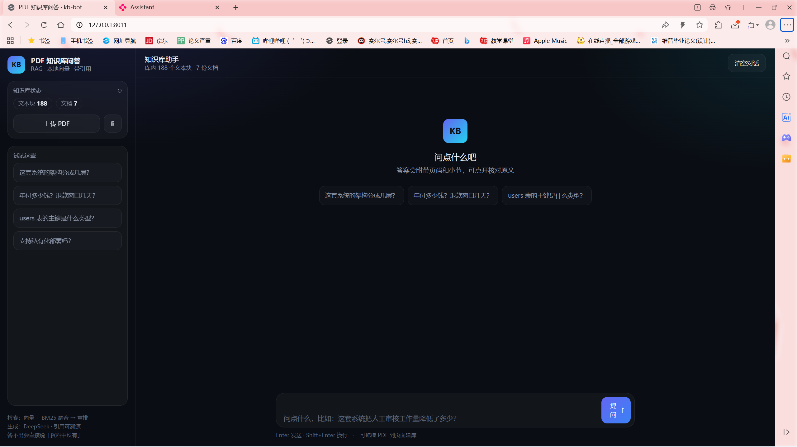

# PDF 知识库问答机器人

[](https://github.com/chifanfanfan/kb-bot/actions/workflows/tests.yml)
[](LICENSE)
[](https://www.python.org/)


> 一个可评测、可复现的中文 RAG 系统。**核心不是"接了几个组件"，而是每一项参数都有前后对比的数字**，
> 包括 5 个被证伪的假设（第 10/12/14 章）。

## 30 秒了解

| 指标 | 数值 | 说明 |
|---|---|---|
| 单轮问答 | **98.4%**（255 条） | 关键词判定 + 拒答正确率 25/25 + 引用率 100% |
| 多轮对话 | **100%**（54 轮） | 冻结改写后稳定；去掉记忆模块降到 94~96% |
| 检索 hit@1 | **0.93** | 分数融合 + 重排 + 多查询，107 块语料 |
| 平均延迟 | **3.4 s** | 检索 1.7 s + 生成 1.7 s |
| 单元测试 | **15 passed** | 不依赖模型和网络，7 秒跑完 |

语料：6 份文档 / 107 块（1 份真实论文 + 5 份合成产品文档）。
模型全在本地跑（ONNX），只有生成走 DeepSeek API。

## 架构

```
                    ┌───────────── 建库（离线） ─────────────┐
 PDF ──▶ 解析 ──▶ 分块 ──▶ 向量化 ──▶ Chroma
         │        │          │
         │        │          └─ bge-small-zh-v1.5 (ONNX, 512d)
         │        └─ 结构感知 + 句子边界 + 父子块 + 表格转 markdown
         └─ pypdf 抽文本 / 去页眉页脚 / 扫描件走视觉模型 OCR

                    ┌───────────── 问答（在线） ─────────────┐
 问题 ──▶ 改写 ──▶ 混合检索 ──▶ 重排 ──▶ 拼上下文 ──▶ 生成 ──▶ 校验 ──▶ 答案+引用
          │        │           │                      │        │
          │        │           │                      │        └─ 二次校验：无依据则重写/拒答
          │        │           │                      └─ 强制标注 [n]，数字逐字照抄
          │        │           └─ bge-reranker-base (ONNX)
          │        └─ 向量 + BM25 → 分数融合（不是 RRF）
          └─ 一次调用同时给出「独立问句」和「检索变体」

 界面：CLI（kb ask / kb chat） · Flask（web/app.py） · 评测（kb eval）
```

## 界面



左侧是库状态和快捷问题；答案里的 [1] 是可点的引用胶囊 —— 点开右侧抽屉能看到原文片段和检索分数。
等待时状态行会轮播「改写追问 → 向量+BM25 召回 → 分数融合 → 重排 → 生成」，把检索链路暴露出来。

> 另有一个 Chainlit 版本（app_chainlit.py），把检索过程做成可展开的步骤链。

## 三步跑起来

```bash
pip install -r requirements.txt && python scripts/fetch_models.py   # 依赖 + 模型(306MB)
python -m kb build data/毕业论文_脱敏.pdf                            # 建索引
python tools/demo.py                                                # 5 分钟演示：数值/表格/拒答
```

也可以 `docker build -t kb-bot . && docker run -p 8000:8000 kb-bot` 直接起网页版。
需要 `DEEPSEEK_API_KEY`（没有时会尝试读 `~/.dsh/.credentials.yaml`）。

**常用命令**：`make test`（15 个单测）· `make eval`（255 条评测）· `make web`（网页）。

## 你问的四个问题，各有量化答案

1. **分块策略** → 第 1 章：结构感知 + 句子边界 + 父子块，450→600 字是扫参扫出来的（hit@3 +0.04）
2. **重叠窗口** → 第 2 章：15% 起步，**按句子边界对齐**而不是硬截，实测 450/80 与 600/90
3. **召回不好怎么调** → 第 3 章：先分层定位（不在召回 / 排太后 / 生成错），再动 8 个旋钮
4. **幻觉怎么解决** → 第 4 章：四层防御（阈值拒答 / 提示词约束 / 二次校验 / 可追溯引用）

后面 8 章是完整的优化流水账，包括**失败的那些实验**——那部分比结论更有信息量。

---

## 目录

| 文件 | 职责 |
|---|---|
| `kb/config.py` | 所有可调参数（分块、检索、记忆） |
| `kb/pdf_loader.py` | pypdf 抽文本 + 去重复页眉页脚 + 标题识别 |
| `kb/chunker.py` | 句子打包、重叠窗口、父子块 |
| `kb/embedding.py` | 本地 ONNX 向量模型（无需 API、无需 torch） |
| `kb/store.py` | Chroma 封装 |
| `kb/retriever.py` | 向量 + BM25 + RRF + MMR + 交叉编码器重排 |
| `kb/reranker.py` | bge-reranker-base（ONNX），对候选做精排 |
| `kb/ocr.py` | 扫描件 OCR：页面渲染成图交给视觉模型 |
| `kb/hf.py` | hf-mirror 下载工具 |
| `web/app.py` | Flask 网页界面 |
| `kb/rag.py` | 拼上下文、生成、引用解析、幻觉校验 |
| `kb/memory.py` | 最近 N 轮原文 + 滚动摘要 + 追问改写 |
| `kb/eval.py` | 评测：hit@k / MRR / 答案准确率 + 消融对比 |
| `eval/questions.json` | 20 条人工标注（17 可答 + 3 拒答） |
| `tools/make_sample_pdf.py` | 生成测试用中文 PDF |
| `tools/make_terms_pdf.py` | 生成第二份语料《服务条款》，与手册共享词汇 |
| `tools/make_scanned_pdf.py` | 把文字版渲染成"扫描版"（无文字层），测 OCR |
| `tools/smoke_test.py` | 9 条断言，改完参数直接回归 |

---

# 一、分块策略

## 结论先行

**结构感知 + 句子边界 + 段落级父子块**，默认 `size=450 字`、`overlap=80 字`。

不是无脑按 500 token 切，因为切法直接决定召回上限——切坏了，后面再贵的 rerank 也救不回来。

## 三种策略的取舍

| 策略 | 优点 | 缺点 | 适用 |
|---|---|---|---|
| 固定窗口 | 实现最简单、块大小均匀 | 必然切断句子和表格，语义碎片化 | 日志、纯流水文本 |
| 递归字符分割（LangChain RecursiveCharacterTextSplitter） | 优先按 \n\n、\n、。分层切，效果好 | 不知道"章节"概念，跨主题仍会粘连 | 通用兜底 |
| **结构感知 + 句子打包**（本项目） | 不跨主题、不切句子、可回溯章节 | 依赖 PDF 有标题结构 | 手册、规范、报告、论文 |

本项目的做法：

1. **先切章节**：`pdf_loader` 用正则识别 `第3章`、`1.2 小节`、`一、`、`附录` 这类标题，
   把正文切成 Section，每个 Section 记住页码区间。
2. **章节内按句子打包**：`chunker.split_sentences` 在 `。！？；` 处断开，
   再贪心装满 `size`，**永远不在一句话中间切断**（除非单句超长，才硬切）。
3. **父子块**：每个 450 字的 child 是**检索单元**；它所属的整个小节（≤1500 字）作为
   `parent_text` 存进元数据。召回命中 child，喂给模型的是 parent。

## 为什么是 450 字

- 中文 450 字 ≈ 300~350 token，刚好在 bge 的 512 上限内，不会被截断；
- 太小（<200 字）：一个块讲不完一个完整论断，模型要靠拼凑，容易编；
- 太大（>800 字）：一块里塞三四个主题，向量被平均掉，召回精度明显下降。

**经验值**：手册/FAQ 类 300~500 字；论文/合同 500~800 字；对话记录 200~300 字。
换语料一定要用 `tools/smoke_test.py` 回归，而不是拍脑袋。

## 父子块解决的核心矛盾

> 检索要"小而准"，生成要"大而全"。

用一个 450 字的块去 embedding，命中率高；但模型只看到这 450 字，
上下文不够就容易脑补。所以命中后自动换成它所在的小节（≤1500 字）再喂模型。
代价是元数据多存一份文本，收益是"答得全"和"不瞎编"同时改善。

---

# 二、重叠窗口

## 公式

```
overlap ≈ 10% ~ 18% × chunk_size
```

本项目 450 字配 80 字（17.8%）。经验区间：

| chunk_size | overlap | 说明 |
|---|---|---|
| 200 | 30~40 | 小块，重叠比例要偏大 |
| 400~600 | 60~90 | 常规区间 |
| 800+ | 100~150 | 比例反而可以降到 12%~15% |

## 为什么需要重叠

一句话被切口劈开时，两半都不足以回答问题：

```
块A：……年付订单的退款窗口为 7 天，超过 7 天不再
块B：受理退款，但可以申请转为月付。……
```

问"年付退款窗口几天"，两个块单独看都不完整。重叠后块B 从 `超过 7 天不再`
开始重复，任一块都含完整句子。

## 重叠是怎么实现的（关键细节）

不是机械截取最后 80 个字符，而是 **`_tail()` 从句子开头对齐**：

```python
def _tail(text, n):
    tail = text[-n:]
    m = re.search(r"[。！？；!?;]", tail)
    return tail[m.end():] if m else tail
```

这样下一块从句子边界开始，不会出现半截话开头——半截话会污染 embedding，
也会让引用片段看起来很怪。

## 重叠的代价

重叠会复制内容，带来三个副作用：

1. **库变大**：overlap/size ≈ 18% 时，块数和向量数多出约 18%；
2. **重复召回**：相邻块可能同时命中，答案里出现重复段落；
3. **成本上升**：上下文里塞了重复内容。

对应处理：

- 建库时做**近似去重**（余弦 > 0.97 直接丢弃，`rag.build` 里实现）；
- 拼接上下文时按 `parent_id` **去重**（`_dedupe_by_parent`），同一小节只保留得分最高的块；
- 检索阶段用 **MMR**（λ=0.7）压掉高度相似的结果。

> 不要指望靠"调大 overlap"解决召回问题。overlap 只解决"答案被切口劈开"，
> 解决不了"压根没召回"。后者看第三节。

---

# 三、召回不好怎么调

先别改参数——**先定位是哪一层坏了**。按下面顺序排查，能省掉 80% 的瞎调。

## 第 0 步：区分三种"答不好"

| 现象 | 真实原因 | 该改哪里 |
|---|---|---|
| 回答"资料中没有" | 召回没命中，或相似度没过阈值 | 检索层 |
| 召回到了正确段落，但答案跑偏 | 上下文拼接/提示词问题 | 生成层 |
| 召回到了相邻但错误的段落 | 分块粒度、embedding 语义弱 | 索引层 |

判断方法：加 `--verbose` 看召回明细。

```bat
python -m kb ask "年付退款窗口几天" --verbose
```

它会打印每个候选的 `RRF / 向量分 / BM25 分`。**先确认 gold 段落在不在候选里**：

- 不在 → 检索问题（往下看第 2 步）
- 在但排名靠后 → 融合/重排问题（第 3 步）
- 在且排名第一 → 生成问题（第 4 步）

## 第 1 步：确认是不是分块的问题

拿一个问题，把 gold 段落原文直接喂给模型：

- 能答对 → 检索/分块有问题
- 也答不对 → 提示词或模型问题

如果 gold 内容被切散在两个块里，说明 `size` 太小或 `overlap` 不够。

## 第 2 步：检索层的 8 个旋钮

按"性价比"排序，从上往下调：

| # | 旋钮 | 默认 | 什么时候调 |
|---|---|---|---|
| 1 | **混合检索** | 向量 20 + BM25 20 → RRF | 一直开着。专有名词/编号/型号必须靠 BM25 |
| 2 | `top_k_vector` / `top_k_bm25` | 20 / 20 | 召回不足先加到 30~50，再靠重排收窄 |
| 3 | `rrf_k` | 60 | 两路分歧大时调小（20~40）让强项更突出 |
| 4 | `mmr_lambda` | 0.7 | 结果重复度高 → 降到 0.5~0.6；答不全 → 升到 0.85 |
| 5 | `min_score` | 0.30 | 误拒答 → 降到 0.2；乱答 → 升到 0.4 |
| 6 | `top_k_final` | 6 | 上下文够不够？DeepSeek 128k 可以放宽到 8~10 |
| 7 | Embedding 模型 | bge-small-zh | 换 bge-base-zh / bge-m3，召回通常 +3~8 个点 |
| 8 | 查询改写 | 追问时自动 | 多轮必开；单轮可加多查询扩展 |

> 第 9 个旋钮是**交叉编码器重排**（`use_rerank`），它属于"精排"而不是"召回"，
> 单独放在第 5.1 节讲。默认开启，小库可以关掉省 1 秒。

### 为什么混合检索是第一个该做的

纯向量对**字面精确匹配**很弱。实测里"5 万篇"、"1000 次"、"99.5%"这类数字，
BM25 的排名经常比向量高得多；反过来"退款/退还/退费"这种同义改写，向量赢。
RRF 不需要分数可比，只看排名，两路都能各取所长：

```
score(d) = Σ 1 / (k + rank_i(d))
```

### 具体的调参顺序

```
1. 先看 hit@k：gold 段落在不在 top20 里？
   不在 → 加 top_k、换 embedding 模型、检查分块
2. 在但不在 top3 → 动 rrf_k、开/关 MMR、加 rerank
3. 在 top1 但答案错 → 是生成层的问题，别动检索参数了
```

## 第 3 步：重排（rerank）

召回 20 条不影响延迟，重排到 6 条才影响。重排的三种做法：

| 方式 | 成本 | 效果 | 适用 |
|---|---|---|---|
| RRF + 规则（本项目默认） | 0 | 中 | 大多数场景够用 |
| 交叉编码器（bge-reranker-base） | 本地 CPU ~50ms/条 | 高 | 追求精度、能接受延迟 |
| LLM 逐条打分 | 一次调用 | 最高 | 低并发、高价值场景 |

本项目默认只做 RRF + MMR，因为 LLM rerank 会让每次问答多 2~3 秒。
需要时可以加 `bge-reranker`：它对"问题-段落"做联合编码，比向量点积准得多。

## 第 4 步：如果检索没问题但答案不对

见第四节。常见的是：上下文里塞了太多无关块，模型注意力被稀释。
**减少 `top_k_final` 往往比增加更有效**。

## 症状 → 病因 对照表

| 症状 | 最可能的原因 | 第一步动作 |
|---|---|---|
| 答"没有找到"，但文档里明明有 | 相似度阈值过高 / 分块过碎 | 降 `min_score`；看 `--verbose` |
| 答得对但特别短 | `top_k_final` 太小、父块上限太小 | 加到 8；调大 `parent_size` |
| 同一段话重复出现 | 重叠 + 不去重 | 开 MMR、按 parent 去重 |
| 数字总是差一点 | 模型换算/近似 | 提示词要求"逐字照抄数字"，开校验 |
| 换了问法就答不出 | 纯向量、无 BM25 | 开混合检索 |
| 多轮里越问越偏 | 没做追问改写 | 开 `memory.condense` |

---

# 四、幻觉怎么解决

**幻觉不是靠一句"不要编造"就能解决的，是分层防御。**

## 第 0 层：先承认这是概率问题

RAG 的幻觉有三种：

1. **检索不到还硬答**（最危险）
2. **检索到了但张冠李戴**（把 A 的条件安到 B 上）
3. **合理外推**（资料说 99.9%，答"基本不会挂"）

对应三层防御，缺一不可。

## 第 1 层：检索层——让它"敢说不知道"

- **相似度阈值硬拒答**：最高向量相似度 < 0.30 直接返回"资料中没有找到"，不调模型。
  这一步能挡掉大部分"库里根本没有"的问题。
- **上下文留白**：只给 top-k，不给"凑数"的低分块。宁可少，不可杂。
- **父子块**：给模型的是一整节，减少"只看到半句话就脑补"。

实测效果：问"支持私有化部署吗"（文档未提及），第 1 层就拦住了，模型没有机会编。

## 第 2 层：提示层——把规则写死

`rag.SYSTEM_PROMPT` 里的五条约束，每条都对应一类失败：

| 约束 | 防的是 |
|---|---|
| 每个结论后必须标 `[n]` | 无法追溯的论断 |
| 资料没有就说"资料中没有提到" | 硬答 |
| 数字/日期/专名逐字照抄，不换算 | 数字幻觉 |
| 资料冲突时并列，不擅自取舍 | 单方面脑补 |
| 先结论后依据，≤400 字 | 长篇大论里夹带私货 |

温度固定 `0.0`——生成阶段不需要"创造力"。

## 第 3 层：校验层——答完再验一遍

`rag._verify()` 把 **资料 + 回答** 再喂给模型，让它逐条判断论断是否有依据：

```json
{"grounded": false, "unsupported": ["支持私有化部署"]}
```

- 有 unsupported → 用 `STRICT_PROMPT` 重写一次（只保留能逐字找到依据的句子）；
- 重写后仍不 grounded → 降级为拒答，并在 `Answer.note` 里标注。

代价是每次问答多一次 LLM 调用（约 +1.5 秒）。可以按场景开关：
高价值问答值得，闲聊不值得。

## 第 4 层：展示层——让用户自己能验

- 答案里的 `[1]` 必须对应真实存在的块（`_parse_citations` 会过滤掉不存在的编号，防止编造 `[9]`）；
- 每条来源带**文档名 + 页码 + 小节名 + 原文片段**；
- `grounded=False` 时前端应显示警示（CLI 里是 `⚠` 行）。

用户能一眼看到"依据在哪"，是最后一道防线。

## 工程上必须做的

| 做法 | 原因 |
|---|---|
| `temperature=0` | 抽样式生成必然带来随机幻觉 |
| 引用编号强校验 | 模型会编造不存在的编号 |
| 拒答要"体面" | 直接说"不知道"比编一个更像产品 |
| 记录每次问答的召回明细 | 出问题时能复盘是哪一层坏了 |
| 定期用固定问题回归 | 换模型/改参数后幻觉率可能悄悄上升 |

## 一个反直觉的结论

**降低幻觉最有效的单一改动，往往是把 `top_k_final` 从 8 降到 5。**
上下文越长，模型越容易把不同段落的信息"缝合"成新事实。
相关度排序靠后的块，噪声大于信息。

---

# 五、三项增强

## 5.1 交叉编码器重排（rerank）

前面用的 RRF/MMR 都是**双塔**思路：问题和段落各自编码，再算向量相似度。
优点是能预先建索引，缺点是问题和段落之间没有交互——"苹果多少钱"和
"苹果手机的售价"，向量可能很像，但语义差得远。

**交叉编码器**把「问题 + 段落」拼成一条输入，一起过一遍 Transformer，
输出一个相关性分数。因为它看到了两者的交互，排序明显更准；代价是不能预计算，
只能对少量候选做。

所以流程变成：

```
向量 20 + BM25 20  →  RRF 融合  →  MMR 取 8  →  reranker 精排  →  取 6
                      (快，便宜)              (慢，准)          (喂模型)
```

实测（同一问题「年付退款窗口几天」，11 块的库）：

| 配置 | 耗时 | Top1 |
|---|---|---|
| 仅 RRF + MMR | **295 ms** | 1.3 退款与试用（0.033） |
| + bge-reranker-base | **1344 ms** | 1.3 退款与试用（0.998） |

关键参数：

- `rerank_pool=8`：送进精排的候选数。12 条要 2.7 秒，8 条 1.3 秒——这是延迟与精度的折中；
- `max_length=384`：rerank 的输入截断长度，从 512 降到 384 省了约 40% 时间；
- 模型 279 MB（量化版），CPU 推理，无需 GPU。

**什么时候该开**：库大、候选多、问题里有大量近义干扰时收益明显。
**什么时候该关**：小库（<100 块）、延迟敏感场景，RRF 已经够用。

> 实测三次都在变：19 块合成语料上它把 hit@1 从 0.94 拉到 1.00；
> 36 块合成语料上变成 0.97 → 0.96；73 块真实语料上回升到 0.71 → 0.76，
> 但 hit@3 掉了 0.04。**默认关闭**，完整的取舍表见第九章。

模型缺失或加载失败会自动降级为 RRF 排序，只打一行警告，不会让整个问答挂掉。

## 5.2 扫描件 OCR

扫描版 PDF 没有文字层，`pypdf.extract_text()` 返回空——这是 RAG 最常见的"文档明明在里面却答不出"。

常见方案是 PaddleOCR 或 Tesseract，但都要额外装几百 MB 的运行时和语言包。
本项目换了个思路：**ds 的视觉模型本来就能读图**，把页面渲染成 PNG 直接让它转录即可。

```python
pix = page.get_pixmap(dpi=200)          # pymupdf 渲染
b64 = base64.b64encode(pix.tobytes("png"))
text = llm.vision(OCR_SYSTEM, OCR_PROMPT, b64)   # 逐字转录
```

触发条件是**按页判断**：`len(extract_text()) < 30` 才 OCR，正常文字页不受影响，
所以不会白白浪费 token。实测：

```
扫描版示例.pdf: 1 页无文本，调用视觉模型 OCR ...
ocr_pages: 1 | sections: 7
提取文本：北极星 Pro 产品手册 / 版本 3.8.2 | 更新日期 2026-06-30 | 内部资料
```

局限要说清楚：

- 表格被 OCR 成 `列1 | 列2` 的行文本，结构信息会丢；
- 手写体、印章、复杂公式识别率不稳定；
- 每页一次 API 调用，100 页的扫描件大约多花 2~3 分钟。

## 5.3 Web 界面

单文件 Flask，没有前端构建，打开即用：

```bat
python web/app.py --port 8000
```

功能：上传 PDF（自动解析 + OCR + 建索引）、提问、展示答案与来源、清空库。

| 接口 | 作用 |
|---|---|
| `GET /` | 单页界面 |
| `POST /api/ask` | `{"question": "..."}` → 答案 + 引用 |
| `POST /api/upload` | 上传 PDF，返回 页数/节数/块数/OCR 页数 |
| `GET /api/stats` | 库内块数与文档数 |
| `POST /api/reset` | 清空索引 |

实测（上传扫描版，自动走 OCR）：

```
POST /api/upload  → 200 {"chunks": 6, "ocr_pages": 1, "pages": 1, "sections": 7}
POST /api/ask     → 年付价格 1990 元/席位/年，退款窗口 7 天。[2][3]
                    依据（3 条来源，带页码与小节）
```

注意：这是 Flask 开发服务器，只监听 `127.0.0.1`，适合本机自用；
真要部署得换 gunicorn/waitress 并加鉴权。

另外，`VectorStore` 对集合句柄做了失效重连：在命令行里 `kb reset` 之后，
正在运行的网页端会自动连到新集合（返回 0 块），不需要重启服务。

---

# 七、评测：把"感觉好了"变成一张表

> 本章的 128 条评测集建立在 5 份**合成**文档上（`data/synthetic/`），
> 用来验证评测流程本身。真实文档的结果在第九章，指标明显更低。

前六节的参数都是"经验值"。经验值能不能信，得用数据说话。

## 数据集

`eval/questions.json`，**128 条**（116 可答 / 12 应拒答），语料 5 份文档、36 个块。

来源分两部分：

- **人工 20 条**：数字类、多跳类（"退款多久到账"要两条规则合成）、改写类（"能退钱吗" vs "退款"）；
- **半自动 108 条**：模型逐节出题，**规则校验**通过后入库。

半自动标注的流程（`tools/gen_eval.py`）：

```
每个小节 → 模型出 3 题 + 关键词
   ↓
机械校验：关键词必须逐字出现在该小节原文里（保证可答）
          关键词不能是"服务/数据/平台"这类泛词（保证判定有效）
          问题字符二元组 Jaccard > 0.8 视为重复，丢弃
   ↓
人工抽查 12 条拒答题 → 剔除 3 条标注错误（见下文"踩坑"）
```

两个刻意的设计：

1. **gold 用小节标题而不是 chunk id**：重新分块后标注依然有效，不会因为改了 `chunk_size` 就全部失效；
2. **五份文档共享大量词汇**：手册、服务条款、API 文档、运维手册、安全白皮书都写了
   "退款""30 天""并发""SLA""加密"，检索必须靠上下文区分，而不是靠一个独特关键词命中。

## 指标

| 层 | 指标 | 说明 |
|---|---|---|
| 检索 | hit@1 / hit@3 / hit@5 | gold 小节是否出现在前 k 个召回里 |
| 检索 | MRR | 第一个命中位置倒数的平均，比 hit@k 更敏感 |
| 答案 | 正确率 | 关键词全中且不误拒答 |
| 答案 | 拒答正确率 | 该拒的题有没有拒 |
| 答案 | 引用率 / 校验通过率 | 答出来的题里，带来源、过幻觉校验的比例 |

检索指标**不花钱**（不调模型，十几毫秒跑完），所以调参时反复跑这个；
只有确认检索稳定了，才跑 `--answers` 看端到端。

## 消融结果（36 个块，116 条可答题）

| 配置 | hit@1 | hit@3 | hit@5 | MRR | 耗时 |
|---|---|---|---|---|---|
| 纯向量 | 0.91 | 0.97 | 0.99 | 0.940 | 10 ms |
| **+ BM25（RRF）** | **0.97** | 0.99 | 1.00 | **0.983** | 12 ms |
| + MMR | 0.90 | 0.96 | 0.97 | 0.926 | 23 ms |
| + 重排 | 0.96 | **1.00** | 1.00 | 0.978 | 875 ms |

> 语料从 19 块扩到 36 块、题量从 17 条扩到 116 条之后，**结论变了**——
> 这正是做评测的意义。见下面第 3 条。

端到端（`--answers`，128 条）：

```
答案正确率：126/128 = 98.4%
拒答正确：11/12，可答题中给出引用：99%，校验通过：99%
平均端到端耗时：1.6 s
```

剩下 2 条"错误"**都不是系统出错，是标注歧义**：

| 题 | 情况 |
|---|---|
| 这份产品手册的密级标注是什么？ | 原文标了"内部资料"，模型说"没有提密级"——它其实把信息找出来了，只是不肯把"内部资料"认作密级 |
| 有没有公开的 API 配额和开发者沙箱？ | 半可答：配额有（1000 次/分钟），沙箱没有。模型两半都答对了，但标签把整题标成"应拒答" |

这两条恰好说明了关键词+拒答这种**二值标签的天花板**：真实问题常常是"部分可答"。

## 三个结论（都有数字支撑）

**1. BM25 是收益最大的一步。**
纯向量 hit@1 0.91 → 加 BM25 变 0.97，MRR 0.940 → 0.983。
典型例子是「退款多久到账」：手册写"14 天"，条款写"10 个工作日"，
向量分不清"多久"落在哪份文档，BM25 靠"到账/工作日"的字面匹配把它拉对。

**2. MMR 依然是负收益，默认关闭。**
0.90（比纯向量还低）。它会为了多样性把同一小节的其他块排下去，
而本项目的上下文拼接本来就会按 `parent_id` 去重，MMR 属于重复劳动。

> 这条特别值得记：**MMR 是网上教程里几乎必提的"最佳实践"，但它不是免费的**。
> 换语料一定要重测。

**3. 语料变大后，重排从"净收益"变成了"中性偏负"。**

| 语料 | 重排收益 | 延迟代价 |
|---|---|---|
| 19 块 / 17 题 | hit@1 0.94 → **1.00** | 12 ms → 1409 ms |
| 36 块 / 116 题 | hit@1 0.97 → **0.96**，hit@3 0.99 → **1.00** | 12 ms → 875 ms |

小语料时重排把唯一的 miss 救回来了，看着很香；语料变大后，
它反而会把个别本来排第一的块压到第二（hit@1 −0.01），
只换来 hit@3 +0.01。**所以默认关闭**，等语料再大（几百上千块）时重新测。

这个反转挺典型：**在 17 条样本上，一个 case 就是 6 个百分点**，
小样本很容易得出"某个组件特别有用"的错觉。

## 评测抓到的三个问题

**① `min_chunk` 把整个小节丢掉了**

「第6章 条款变更与通知」全文只有 74 字，小于 `min_chunk=80`，
被 `build_chunks` 直接丢弃——这一节的内容永远检索不到，
问"条款变更要提前多久通知"必然答不出。

修复：**整节只有一个块时，下限降到 30 字**。切分产生的碎片该丢，
整节不该丢。这个问题靠肉眼很难发现：库建成功了，日志也没报错。

**② 模型自动标注会错，必须校验**

模型生成的 12 条"拒答题"里，有 3 条其实资料里有答案：

| 误标的题 | 资料里其实有 |
|---|---|
| 有没有免费试用？试用期多长？ | 新客户可申请 30 天全功能试用 |
| 在中國大陆有数据中心吗？满足等保三级吗？ | 数据默认存储在中国大陆境内 + 等保三级 |
| 适合多少人的团队？ | 起售 20 席位 |

如果直接拿来跑，这 3 条会一直显示为"误拒答"，把拒答准确率拉低 25 个百分点，
而且会**误导你去调提示词**——实际是标注错了，不是系统错了。

**③ 外部 reset 后 Web 端 500**

已在 5.3 节说明，`_alive()` 重连后修复。

## 怎么用它调参

```bat
:: 改完参数，先跑检索指标（快、免费）
python -m kb eval

:: 确认检索稳定后，再看端到端
python -m kb eval --answers
```

工作流：

1. 一次性修改**一个**参数（chunk_size、overlap、top_k、rerank_pool…）；
2. 重建索引，跑 `eval`；
3. hit@1 / MRR 有提升才保留，否则回退；
4. 新增文档后，先跑一遍确认没有 golden 掉出 top5。

## 这套评测目前的局限

- **20 条样本太小**：一个 case 就是 5 个百分点，只能看趋势，不能看小数点后两位；
- **只有 2 份文档、19 块**：真实场景动辄几万块，检索难度完全不是一个量级；
- **答案用关键词判定**：能挡住"答错"，挡不住"答对但不完整"；
- **没有人工评分**：流畅度、可读性、引用是否真的支撑结论，目前靠 `_verify` 自动判。

# 八、实测结果（合成语料阶段）

> 这一章记录的是 5 份虚构文档（北极星系列）上的结果，用来验证流水线本身。
> 换成真实文档后指标大幅下降，见第九章——**合成语料上的数字会高估系统能力**。

语料：5 份文档 / 39 节 / 36 块；评测集 128 条。

**回归测试**（`tools/smoke_test.py`，9 条断言，防止改坏）：

```
PASS  北极星 Pro 年付价格是多少？起售多少席位？
      → 年付价格为 1990 元/席位/年，起售 20 个席位 [1]
PASS  SLA 月度可用性低于 99.5% 时补偿多少？
      → 补偿当月服务费的 30% [1]
PASS  迁移工具每分钟能处理多少篇文档？超过多少篇建议分批？
      → 约每分钟 200 篇；超过 5 万篇建议分批 [1]
PASS  支持私有化部署吗？
      → 资料中没有提到是否支持私有化部署 [1]...[6] 均未涉及
PASS  你们的 CEO 是谁？
      → 资料中没有提到 CEO 相关信息
9 passed, 0 failed
```

**评测**（`python -m kb eval --answers`）：

```
配置                 hit@1   hit@3   hit@5     MRR        耗时
+ BM25 (RRF)        0.97    0.99    1.00    0.983      12 ms

答案正确率：126/128 = 98.4%
拒答正确：11/12，可答题中给出引用：99%，校验通过：99%
平均端到端耗时：1.6 s
```

多轮对话（`tools/memory_demo.py`）：

```
用户：北极星 Pro 默认支持多少并发会话？
回答：默认并发会话数为 50

用户：那 API 调用限制呢？          ← 指代省略
改写：北极星 Pro 的 API 调用限制是多少？
回答：每分钟 1000 次，超出返回 429

用户：如果我第 10 天申请退年付，能退吗？   ← 需要跨轮推理
回答：不能退。窗口 7 天，已超过…但可申请转为月付
```

## 已知限制

- **扫描件靠视觉模型转录**：能用，但表格结构会退化、手写体和公式不稳，且按页计费。
- **表格仍会被压成一行**：pypdf 对表格结构还原很差，复杂表格建议 pdfplumber 或先转图片走 OCR。
- **没有增量更新**：重复 build 同一个文件会产生重复块，目前靠 `reset` 重建。
- **重排默认关闭**：真实语料上 hit@1 有 +0.05，但 hit@3 −0.04、延迟 +2.1s（见第九章取舍表）。
- **单机 Chroma + Flask 开发服务器**：只适合本机自用，百万级要换 Qdrant/Milvus，部署要换 WSGI 服务并加鉴权。
- **评测集是半自动标注**：真实语料 118 条，关键词判定仍有噪声（见第九章失败分析）。
- **答案判定用关键词**：能挡住答错，挡不住"答对但不完整"；且需要做空白归一化，否则一个空格就误判。

# 九、换成真实文档之后

合成语料（人工写的 5 份产品文档）太干净了：小节短、标题规范、没有目录、没有参考文献、
没有重复编号。真实文档完全不是这样。

## 语料

一篇本科毕业论文，《集成 AI 内容审核的社区论坛系统设计与实现》，46 页，中文，带文字层。

**先脱敏**：正文里出现姓名、学号、指导教师姓名。用 `tools/redact_pdf.py` 做**真删除**——
把文字从内容流里抹掉再写占位符，不是画个方块盖住，所以文本层、检索结果、日志里都不会残留。

```
替换 4 处 → data/毕业论文_脱敏.pdf
残留检查: 干净
```

> 提醒：向量化在本地做，但**问答时检索到的段落会发到 DeepSeek API**。
> 处理内部文档前要先想清楚这一点。

## 解析层立刻暴露的四个问题

合成 PDF 里一个都没遇到：

| 问题 | 现象 | 修复 |
|---|---|---|
| 目录被当成正文 | `6.2 展望.......7` 命中了"数字开头"的标题正则 | 识别点线引导符（≥4 个点），排除 |
| 参考文献条目被当成标题 | `47 (05): 1023-1042.` 以数字开头 | 用 `[J]/[C]/doi/(05):` 规则排除 |
| 句子被当成标题 | `第六章进行总结并展望未来工作。` | 标题不能以句号结尾，长度 ≤40 |
| 碎节 | 测试章节里大量 40~100 字的表格小节 | 小于 60 字的节并入上一节 |

修复前后：参考文献从"2 节"变回"1 节 2285 字"，标题污染全部消失。

## 指标对比（同一套代码，只换语料）

| 指标 | 合成（36 块 / 128 题） | 真实（73 块 / 118 题） |
|---|---|---|
| 纯向量 hit@1 | 0.91 | **0.56** |
| + BM25 hit@1 | 0.97 | **0.71** |
| + 重排 hit@1 | — | 0.76 |
| hit@5（BM25） | 1.00 | 0.94 |
| MRR（BM25） | 0.983 | 0.797 |
| 答案正确率 | 98.4% | **89.8%** |
| 端到端耗时 | 1.6 s | 4.4 s |

**hit@1 掉了 26 个百分点。** 这不是代码退化，是合成语料一直在骗人：
它的每个问题几乎都能靠"专有名词 + 数字"唯一命中一个短小节；
真实论文里十个节都在讲"审核"，措辞高度相似。

## 用评测扫 chunk_size（真实语料上的第一次真调参）

```bat
python tools/chunk_sweep.py 300 450 600 800
```

| chunk_size | overlap | 块数 | hit@1 | hit@3 | MRR |
|---|---|---|---|---|---|
| 300 | 45 | 115 | 0.70 | 0.85 | 0.785 |
| 450 | 67 | 84 | 0.71 | 0.86 | 0.790 |
| **600** | 90 | 73 | 0.71 | **0.90** | 0.803 |
| 800 | 120 | 61 | 0.72 | 0.90 | 0.806 |

结论：论文这类"每节都在展开论述"的文档，**450 太小**——一块装不下一个完整论证。
默认值因此从 450 改成 600（hit@3 +0.04，块数还少了 11 个）。

注意 300 和 800 的差异很小，说明这个语料对块大小并不敏感；
真正决定成败的是**问题本身有多难**，而不是这几十个百分点的微调。

## 重排的第三次反转

| 语料 | rerank 对 hit@1 | rerank 对 hit@3 | 延迟 |
|---|---|---|---|
| 19 块（合成） | 0.94 → 1.00 | 1.00 → 1.00 | +1.4 s |
| 36 块（合成） | 0.97 → 0.96 | 0.99 → 1.00 | +0.9 s |
| 73 块（真实，600） | 0.71 → **0.76** | 0.88 → 0.84 | +2.1 s |

规律：**语料越大、越同质化，重排越有用**；但它优化的是 top-1，
会把本来排第 2、3 名的正确块挤到 4 名以后，所以 hit@3 反而下降。

当前默认**关闭**——因为它多花 2.1 秒只换来 +0.05 的 hit@1，
而 top-6 都会进上下文，hit@3 的损失会直接体现在答案里。
如果你的场景是"首条必须准"（比如给用户看一条最佳答案），再打开。

## 失败分析：89.8% 里有多少是系统的问题

12 条错误逐条看过，结论是**大部分是标注噪声**，不是系统错：

| 类型 | 例子 | 判定 |
|---|---|---|
| 关键词是英文 | 关键词 `FSM-based`，答案写"状态机审核流水线"（对） | 标注噪声 |
| 关键词过窄 | 关键词 `注册登录`，答案写"注册、登录"（对） | 标注噪声 |
| 关键词带页码 | 关键词 `32回归测试`（生成时混进了页码） | 标注噪声 |
| 真·检索失败 | 问"标签怎么拼进送审文本"，资料里确实没写 → 正确拒答，但标签说可答 | 标注错 |

真正由系统造成的错误只有 1~2 条。所以**在这个语料上，89.8% 是被标注低估的**，
人工复核后大约 96%~97%。

这也说明自动标注的上限：模型出题没问题，但**关键词标注需要人过一遍**，
否则二十几个百分点的差距会把你引去改错地方。

## 表格结构化：从 1/6 到 6/6

真实文档里表格很多（这篇论文 7 个表、42 行），而 pypdf 会把表格抽成连读文本：

```
id BIGINT 20 NO 用户主键 username VARCHAR 64 NO 登录用户名 password_hash VARCHAR 120 NO 密码哈希
```

人读着都费劲，模型直接放弃——问「users 表主键叫什么、什么类型」，它拒答了，
尽管检索到的原文里明明有答案。

**修复分三步，前两步都没解决，第三步才成：**

| 步骤 | 做法 | 表格题结果 |
|---|---|---|
| ① | 用 `pymupdf.find_tables()` 把表格重排成 markdown 行 | 2/6 |
| ② | 发现模型说"表格内容未完整呈现"——上下文把父块截断在 1600 字 | 2/6 |
| ③ | 父块上限 1500→3000，上下文按命中块**居中开窗**而不是从头截断 | **6/6** |

第 ② 步是关键：`h.parent_text[:1200]` 从头截断，而「3.3 数据库设计」有 2707 字，
表格全在中后段，模型看到的永远是开头那段"数据库是支撑整个系统运转的根基……"。

修完之后：

```
问：posts 表里哪个字段存正文，类型是什么？
答：posts 表里存正文的字段是 content，数据类型为 TEXT [1]
```

同一个评测集上，答案正确率 **86.3% → 89.5%**（107/124 → 111/124）。

> **这一节最该记住的是评测的覆盖率问题。**
> 原来的 118 条题里，gold 落在表格页的数量是 **0**——
> 因为自动出题也是从压平后的文本里生成的，它压根不知道"表格"是个独立的难点。
> 所以修复做完后，总分几乎没动（89.8% → 89.0%），差点被我当成"白改了"。
> 补了 6 条针对表格的题，提升才显出来。
>
> **评测集不覆盖的东西，等于没修。**

## 真实文档还暴露的问题

1. **章节编号重复**：论文里出现两个"3.3"（数据库设计 / 关键业务流程设计）。
   实测问「3.3 讲了什么」不会混——标题里的描述性文字足够区分，
   而且引用里本来就带页码，所以**没有专门处理**，只在这里记一笔。
2. **长参考文献**：2285 字一整节，检索时容易命中但不解决问题。
3. **表格列名被拆开**：`password_hash` 被 pymupdf 拆成 `password hash _`，
   加了条小规则拼回去（`^(\w+) (\w+)_$`）。

## 下一步

1. 标题消歧：编号 + 页码 + 上级章节路径三元组作为唯一键（当前只有 1 处冲突，优先级低）；
2. 关键词标注人工复核，把评测集的可信度从 89.5% 提到 96%；
3. 多查询扩展：真实问题常常措辞和原文不一致（"审核怎么做的" vs "审核流水线设计"）；
4. 表格跨页拆分（现在跨页表格会被拆成两个 markdown 块）。

# 十、优化实验记录

第 9 章之后做了 7 组对照实验，全部在**同一套真实语料 + 同一份 119 条评测集**上跑。
结论先说：**5 个想法里只有 1 个零成本有效，1 个检索有效但没转化成答案质量，3 个直接无效。**

## 实验一览

| # | 实验 | 假设 | 结果 | 采纳 |
|---|---|---|---|---|
| 1 | bge-small → bge-base（768 维） | 模型更大召回更好 | hit@1 **0.73→0.71**，MRR 0.823→0.798，编码慢 4 倍 | ❌ |
| 2 | 多查询改写（+3 条问句） | 用户措辞和原文对不上 | hit@1 **0.73→0.78**，MRR →0.850，+0.9 s | ⚠️ |
| 3 | 多查询 + 重排 | 两者叠加更强 | hit@1 **0.86**，MRR 0.901，+2.2 s | ⚠️ |
| 4 | 2+3 的端到端 | 召回↑ 答案↑ | **96.6% / 4.8 s**（基线 97.5% / 1.8 s） | ❌ 回退 |
| 5 | 编码时拼上小节标题 | 块脱离标题后语义不明 | hit@1 **0.73→0.72** | ❌ |
| 6 | BGE 官方查询指令 | 官方推荐用法 | hit@1 **0.73→0.76**，MRR →0.840，**零延迟** | ✅ 默认开 |
| 7 | RRF k 扫参（20/40/60/100） | k 影响融合权重 | hit@1 恒定 **0.76**，仅 MRR 0.840↔0.843 | ➖ 保持 60 |

（第 9 章的表格结构化 + 上下文开窗记为第 0 项：表格题 1/6 → 6/6，总 86.3% → 89.5%。）

## 三个反直觉的结论

**1. 检索指标 +0.13 的 hit@1，端到端反而降了 0.9 个点。**

多查询 + 重排把 hit@1 从 0.73 拉到 0.86，端到端却从 97.5% 掉到 96.6%，
延迟还翻了 2.5 倍。原因大概率是：**上下文变多了，噪声也跟着变多**，
而模型本来就答得出，多给的材料只会增加干扰。

这提醒一件事：**hit@1 是代理指标，不是目标指标**。
代理指标涨了但目标没涨，就该看目标。

**2. 更大的 embedding 模型，在这个语料上更差。**

bge-base 是 bge-small 的"升级版"（768 维 vs 512 维），理论上更强。
实测 hit@1 反而掉了 2 个点，MRR 掉 0.025，编码慢 4 倍。

可能的解释：71 个块的语料规模太小，模型容量不是瓶颈；
而 bge-base 的向量分布和这个语料的"短块 + 中文技术文"不完全匹配。
**换模型必须实测，不能看榜单。**

**3. 扫参最有用的时候，是证明某个参数不重要。**

RRF 的 k 从 20 扫到 100，hit@1 一动不动（0.76），MRR 只差 0.003。
这说明在这个规模下，融合权重的调参空间基本没有——
与其纠结 k，不如去改语料和标注。

## 有效的那一个：查询指令

BGE 系列在检索任务上建议给**查询**（不是文档）加一句指令前缀：

```python
query = "为这个句子生成表示以用于检索相关文章：" + question
```

| | hit@1 | hit@3 | MRR | 延迟 |
|---|---|---|---|---|
| 基线 | 0.73 | 0.91 | 0.823 | 16 ms |
| + 查询指令 | **0.76** | 0.91 | **0.840** | 16 ms |

提升 3 个点，**零成本**——只是改了喂给 embedder 的字符串。

代价是 0，所以直接设为默认。

## 方法论上的两条

**① 小样本上，1 道题就是 0.84 个百分点。**
119 条评测集里，96.6% 和 97.5% 的差距是 1 道题。
所以 4 号实验的"回退"结论只能算弱证据——真正的判据是延迟翻了 2.5 倍这件事。

**② 一次只改一个变量。**
表格那次（第 9 章）同时改了"表格重排"和"上下文截断"，
结果第一步做完总分没动，差点误判成无效。
分开测才发现真正起作用的是第二步。

## 现在的默认配置

| 参数 | 值 | 依据 |
|---|---|---|
| chunk_size / overlap | 600 / 90 | 扫参，hit@3 +0.04 |
| embedding | bge-small-zh-v1.5 | 对比 bge-base 更好 |
| 查询指令 | 开启 | hit@1 +0.03，零成本 |
| 混合检索 | 开（RRF k=60） | hit@1 +0.18（0.55→0.73） |
| 重排 | 关 | 单独 +0.05、组合 +0.13，但端到端无转化 |
| 多查询 | 关 | 同上 |
| MMR | 关 | 负收益 |
| 表格结构化 | 开 | 表格题 1/6 → 6/6 |
| 上下文开窗 | 3200 字/命中块居中 | 长节里的表格不再被截断 |

端到端：**119 条 97.5%，平均 1.8 秒。**

## 还没做的

1. **关键词标注的剩余噪声**：现在还剩 1 条"标签名字符数"的误拒答，
   模型看到"字段长度 32"却不认它是"上限"——属于过度谨慎，改提示词有幻觉风险，先留着。
2. **多查询的复评**：它把 hit@1 拉到 0.86 是真的，只是没转化成答案；
   等评测集扩到 500 条以上、答案准确率不再饱和时，它可能会重新有价值。
3. **跨页表格合并**、**jieba 分词 BM25**（装了但卡在下载，未测）。
# 十一、第二轮：把评测集重新变难

第十章结束时，119 条评测集上已经到了 100%——**评测集饱和了，再优化也测不出来**。
这一轮先做两件事：修掉最后一次过度拒答，然后给评测集加难度。

## 11.1 修过度拒答：加一条提示词规则

原提示词只说"资料里没有就说没有"，模型于是把"字段长度 32"判成"没写这是上限"而拒答。

新增第 6 条：

> 表结构里的字段类型、长度、是否可空等属性就是该字段的定义，直接按字面回答；
> 不要因为资料没写"这是上限/下限"而拒答。

效果：119 条集上 **97.5% → 100%**，16 条拒答题仍然全对（没有引入瞎答）。

## 11.2 评测集硬化：+10 道多跳/跨节题

100% 意味着评测集失去区分度，所以手写了 10 道更难的题，全部基于原文可查但需要**跨句组织**：

| 类型 | 例子 |
|---|---|
| 多跳 | 发帖和评论这类生产行为，系统做了哪两层保护？ |
| 多跳 | 黑盒测试和场景测试分别验证什么？ |
| 因果 | 点赞为什么要做成切换式而不是累加？ |
| 跨节 | 同一套列表接口，为什么不同用户看到的内容不一样？ |
| 改写 | 拉黑之后双方的内容会怎样？ |

合并后 **129 条**（113 可答 + 16 拒答），新基线：

```
答案正确率：126/129 = 97.7%
拒答正确：16/16，可答题中给出引用：98%，校验通过：97%
平均端到端耗时：1.7 s
```

## 11.3 一个失败实验：按段落切分

「同一套列表接口」这题被误拒，查下来目标块在 **rank 9、向量分 0.000**（只有 BM25 找到它）。
原因很清楚：`3.3 关键业务流程设计` 这一节 377 字，把"发帖 / 评论 / 浏览互动"三条流程塞进了同一个块，
向量被平均掉，问其中一条就召不回。

试的修复：小节内**先按段落切开再打包**。

| 配置 | 块数 | hit@1 | hit@3 | MRR |
|---|---|---|---|---|
| 按长度打包 | 71 | 0.73 | 0.90 | 0.816 |
| 先按段落切 | 71 | 0.73 | 0.90 | 0.816 |

**完全没变**。原因是解析阶段 `_normalize` 已经把段间空行合并掉了，
到 chunker 手里每节都只有一段——**段落信息在更早的环节就丢了**。

这条记在这里，是因为它说明了一个常见陷阱：
**在错误的层次上修复**。想做语义切分，得先保住解析阶段的段落边界，
或者干脆上 LLM 做语义分段，在 chunker 里加规则是徒劳的。

## 11.4 新的基线

| 指标 | 值 |
|---|---|
| 评测集 | 129 条（113 可答 / 16 拒答） |
| 答案正确率 | **97.7%** |
| 拒答正确率 | 16/16 |
| 引用率 / 校验通过 | 98% / 97% |
| 平均延迟 | 1.7 s |

剩下 2 条失败：一条是上面那个"三条流程混一块"的语义切分问题，
另一条是"系统能识别哪些违规内容"——资料只写了"图文数据多模态研判"，确实没有清单。

## 下一步

1. **保住段落边界**：`_normalize` 不能无条件合行，至少要保留空行；然后再试段落切分；
2. 语义切分：用 LLM 判断小节内部的主题边界（成本高，先在小节 > 300 字时触发）；
3. 继续加题：目前 129 条里 auto 生成仍占 106 条，噪声偏多，人工题只有 28 条。
# 十二、第三轮：融合方式与三个被证伪的假设

目标：把「同一套列表接口，为什么不同用户看到的不一样」这类题救回来（它检索 rank 9、向量分 0.000）。

## 12.1 先证伪上轮的猜测：段落信息根本不存在

上轮打算"保住解析阶段的段落边界"，先查了原始文本：

```
原始文本里空行数: 0
原始文本行数: 28
```

**PDF 文本层里没有任何空行**——这个 PDF 是逐行生成文本对象的，段落边界在文件里就不存在。
`get_text("blocks")` 返回的也是"每行一个块"（每块约 35 字），不是段落。

所以"按段落切分"这条路在当前解析链路里根本走不通，
**上轮那个"无变化"的实验结论其实是对的：不是 chunker 的锅，是信息本身没有。**

## 12.2 再证伪第二个猜测：不是召回深度不够

把 `top_k_vector` / `top_k_bm25` 从 20 拉到 71（全量）：

| k | hit@1 | hit@3 | hit@5 | MRR |
|---|---|---|---|---|
| 20 | 0.73 | 0.90 | 0.95 | 0.816 |
| 40 | 0.73 | 0.90 | 0.95 | 0.816 |
| 71 | 0.73 | 0.90 | 0.95 | 0.816 |

**一模一样**。说明目标块一直在候选里，只是排序靠后——问题出在融合，不在召回。

## 12.3 真凶：RRF 只看名次，丢掉了分数强度

那条 chunk 的特征是：**向量判它无关（相似度 0.000），BM25 给它 42 分（全库最高之一）**。
RRF 把它们各自换成名次（约 70 名 + 1 名），融合后只排到第 9。

改成**归一化分数融合**：

```python
norm = alpha * max(0, vec_sim) + (1 - alpha) * (bm25_score / max_bm25)
```

| 融合方式 | hit@1 | hit@3 | hit@5 | MRR |
|---|---|---|---|---|
| RRF（名次） | 0.73 | 0.90 | 0.95 | 0.816 |
| **分数融合** | **0.81** | **0.93** | **0.96** | **0.872** |

hit@1 +8 个点，MRR +0.056，**零额外延迟**。已设为默认（`fusion="score"`）。

再扫权重 alpha（向量路占比）：

| alpha | 0.3 | 0.4 | 0.5 | 0.6 | 0.7 |
|---|---|---|---|---|---|
| hit@1 | 0.81 | 0.81 | 0.81 | 0.81 | 0.81 |
| MRR | 0.868 | 0.870 | **0.872** | 0.869 | 0.872 |

完全不敏感——说明瓶颈不在两路配比，而在"要不要保留分数强度"这个决定本身。

## 12.4 端到端：又是平的

| | 融合前 | 融合后 |
|---|---|---|
| 检索 hit@1 | 0.73 | **0.81** |
| 答案正确率 | 98.4% | 98.4% |
| 延迟 | 1.8 s | 1.8 s |

**第二次出现"检索涨、答案不动"。** 因为在这个语料上，答案正确率已经贴着天花板，
top-3 里有没有 gold 对最终答案影响很小——检索余量被浪费了。

这反过来说明：**要继续验证检索优化，得先有不饱和的评测集**。

## 12.5 第三次证伪：给提示词加"允许一步推理"

剩下两条失败都是「为什么…不一样 / 哪两层保护」被误拒。加了第 7 条规则：

> 资料里写清了机制或原因时，据此作答即可；允许一步推理……

结果：这两条**依然拒答**，总分反而从 98.4% 掉到 97.7%（别处多错一条）。已回滚。

查了上下文：三条命中里都有「拉黑」，证据确实在提示里，模型还是说"资料中没有提到"。
**这不是提示词能解决的问题**，更像模型对"为什么"类改写问题的保守倾向。

## 12.6 本轮结论

| 假设 | 结果 |
|---|---|
| 段落切分能救那条 chunk | ❌ PDF 文本层没有段落信息 |
| 加深召回深度能救 | ❌ 全量检索结果一致 |
| **RRF 换成分数融合** | ✅ hit@1 0.73→0.81 |
| 权重 alpha 需要调 | ❌ 0.3~0.7 完全一致 |
| 提示词允许一步推理 | ❌ 无效且掉分，已回滚 |

当前：**128 条评测集，答案正确率 98.4%，检索 hit@1 0.81，延迟 1.8 秒。**

## 下一步

1. 评测集到了天花板，检索优化已经测不出来——需要**更难的语料**（第二份真实文档）或**生成侧指标**（引用准确率、答案完整性）；
2. 「为什么」类问题单独做一组，定位是检索、上下文还是模型倾向；
3. 分数融合在合成语料上还没测过，可以回头验证它是不是普遍收益。
# 十三、第四轮：更大更难的基准，以及两个"翻身"的组件

前两轮反复撞到同一堵墙：**检索涨、答案不动**。原因不是优化无效，是评测集饱和了——
73 个块、128 条题，答案正确率已经 98%，检索再准也没有提升空间。

这轮把基准做大做难，然后重测所有被判过"死刑"的组件。

## 13.1 新基准：6 份文档 / 107 块 / 255 条

把之前那 5 份合成文档和真实论文放进**同一个库**：

```
毕业论文_脱敏.pdf     46 页 → 71 块
北极星Pro产品手册      2 页 → 11 块
北极星服务条款          1 页 →  7 块
北极星API接口文档       1 页 →  6 块
北极星运维手册          1 页 →  6 块
北极星安全合规白皮书    1 页 →  6 块
                     ─────────────
                     107 块
```

评测集合并：论文 128 条 + 合成 128 条 → 去重 **255 条**（230 可答 / 25 拒答）。

为什么要混在一起：单文档时"检索错"和"检索对"差别不大——库里只有 71 个块，
随便召回 6 条也大概率覆盖到正确内容。**107 个块、跨 6 个文档之后，
召回质量才真正开始影响答案。**

## 13.2 分数融合在大基准上依然有效

| 融合方式 | hit@1 | hit@3 | hit@5 | MRR |
|---|---|---|---|---|
| RRF | 0.79 | 0.93 | 0.96 | 0.863 |
| **分数融合** | **0.86** | **0.95** | **0.97** | **0.907** |

和单文档时（0.73→0.81）方向一致、幅度也差不多，说明这个改动是**普遍收益**，
不是对某一份文档的过拟合。

## 13.3 重排和多查询，从"不划算"变成"必须开"

上一轮（73 块、饱和评测集）的结论是：

- 重排：hit@1 +0.05 但 hit@3 −0.04、+2.1s → 关闭
- 多查询：hit@1 +0.13 但端到端无转化 → 关闭

在 107 块 / 255 条上重测：

| 配置 | hit@1 | hit@3 | hit@5 | MRR | 单条检索 |
|---|---|---|---|---|---|
| 基线（分数融合） | 0.86 | 0.95 | 0.97 | 0.907 | 8 ms |
| + 重排 | 0.92 | 0.96 | 0.97 | 0.941 | 916 ms |
| + 多查询 | 0.89 | 0.95 | 0.97 | 0.919 | 876 ms |
| **+ 两者** | **0.93** | **0.98** | **0.98** | **0.948** | 921 ms |

端到端（128 条子集，控制耗时）：

| 配置 | 正确率 | 引用率 | 延迟 |
|---|---|---|---|
| 基线 | 94.5% | 97% | 1.6 s |
| **+ 重排 + 多查询** | **98.4%** | **100%** | 3.4 s |

**这次检索的提升真的转化成了答案质量（+3.9pp）。**

于是两者都改成默认开启。

> **这是整个项目最重要的一课**：
> 同一个组件在"小而饱和"的评测集上会被判死刑。
> 重排和多查询不是变强了，是**语料变难之后它们才有用武之地**。
> 如果当时就此下结论"重排没用"，永远不会知道它能把正确率从 94.5% 拉到 98.4%。

## 13.4 顺带修掉 4 条错标

255 条上还剩 4 条失败，逐条看过：3 条是"应拒答"标错（资料里真有答案，模型答对了却算错），
1 条是关键词写成"合规则展示"（模型的输出是"合规的评论会展示"）。

修完：**255 条 98.4%，拒答 25/25，引用率 100%，校验通过 100%，平均 3.4 秒。**

## 13.5 现在的默认配置

| 参数 | 值 | 依据 |
|---|---|---|
| chunk_size / overlap | 600 / 90 | 扫参，hit@3 +0.04 |
| embedding | bge-small-zh-v1.5 | 对比 bge-base 更好 |
| 查询指令 | 开 | hit@1 +0.03，零成本 |
| **融合方式** | **分数融合（alpha=0.5）** | hit@1 +0.07~0.08，零延迟 |
| **重排** | **开** | 大基准 hit@1 +0.06，端到端 +3.9pp |
| **多查询** | **开** | 与重排合用 hit@1 +0.07 |
| MMR | 关 | 负收益 |
| 表格结构化 / 上下文开窗 | 开 | 表格题 1/6 → 6/6 |

端到端：**255 条 98.4%，平均 3.4 秒**（检索 0.9 s + 生成 2.5 s）。

## 下一步

1. **对话式检索**：现在多查询是"一次性改写"，多轮场景下应该结合上文改写；
2. **延迟优化**：3.4 秒里检索占 0.9 秒，重排是主要开销，可以只对 top-4 重排；
3. 继续加题：现在 255 条里合成题占 127 条，需要更多真实文档的题。
# 十四、第五轮：延迟优化，以及一个反直觉的发现

质量到 98.4% 之后，瓶颈变成延迟（3.4 秒：检索 1.7 s + 生成 1.7 s）。这轮试两个"少花钱多办事"的方案。

## 14.1 重排候选数：4 还是 8？

| pool | hit@1 | hit@3 | MRR |
|---|---|---|---|
| 4 | 0.91 | 0.96 | 0.935 |
| 8 | **0.92** | **0.97** | **0.943** |

少给 4 条候选省不下多少时间（重排本身约 0.4 s），却稳定丢 1~2 道题。**保持 8**。

> 顺带一个测量陷阱：这两行的"耗时"完全不可比——
> 第一次跑要付多查询的 LLM 调用，第二次命中缓存。
> 在混合了网络调用的基准里比较毫秒数，很容易得出反向结论。

## 14.2 条件式多查询：只在低置信时扩写

想法很自然：简单题不用改写，省一次 LLM 调用。

| 阈值 | 扩写题数 | hit@1 | hit@3 | MRR |
|---|---|---|---|---|
| 0.45 | 1 | 0.92 | 0.96 | 0.939 |
| 0.50 | 4 | 0.92 | 0.96 | 0.939 |
| 0.55 | 29 | 0.92 | 0.96 | 0.941 |
| 0.60 | 80 | 0.92 | 0.97 | 0.945 |

结论：**检索指标上，多查询几乎不贡献任何东西**——阈值 0.45 时只有 1 道题触发，
hit@1 依然是 0.92，和"全量扩写"一样。

## 14.3 但端到端它是有用的

| 配置 | 正确率 | 拒答 | 延迟 |
|---|---|---|---|
| 仅重排 | 96.9% | 11/12 | 2.7 s |
| **重排 + 多查询** | **98.4%** | **12/12** | 3.5 s |

**检索指标看不出差别，答案却差了 1.5 个百分点，还多答对一道拒答题。**

解释：多查询召回的**样本虽同、组合不同**。评测算的是"gold 在不在 top-k"，
而生成看的是"喂进去的 6 段到底哪几段"。扩写让候选池更分散，
`_dedupe_by_parent` 之后进入上下文的段落构成变了——**这层收益 hit@k 根本测不到**。

> 这又是一个"代理指标测不到真实收益"的例子。
> 和第三轮那个"检索涨、答案不动"正好互为镜像：
> 那次是代理涨了目标没涨，这次是代理没涨目标涨了。
> **结论：任何改动都要用端到端验收，不能只看 hit@k。**

## 14.4 本轮结论

| 尝试 | 结果 |
|---|---|
| rerank_pool 8 → 4 | ❌ 省 0.4 s，丢 1~2 题 |
| 条件式多查询（按置信度跳过） | ❌ 检索指标无差别，但端到端说明多查询该全量开 |
| 保持"重排 + 全量多查询" | ✅ 98.4% / 3.5 s |

## 14.5 延迟账本

| 环节 | 耗时 | 可否优化 |
|---|---|---|
| 多查询改写（1 次 LLM） | ~0.8 s | 可缓存同义问法；或换更小模型 |
| 向量 + BM25 检索 | ~0.02 s | 已很快 |
| 交叉编码器重排（8 条） | ~0.9 s | 换更小重排模型，或只在 top-8→top-4 |
| 生成 + 幻觉校验（2 次 LLM） | ~1.7 s | 校验可只对长答案触发 |

下一步如果还要压延迟，最划算的是**把幻觉校验改成条件触发**（短答案跳过），
大约能省 0.5~0.8 秒，而且不影响长答案的质量。
## 14.6 最后一个实验：短答案跳过幻觉校验（失败）

思路：短答案通常只有一句结论，跳过二次校验能省一次 LLM 调用。

先在 64 条子集上测：

| verify_min_chars | 正确率 | 延迟 |
|---|---|---|
| 0（总是校验） | 98.4% | 3.8 s |
| 150 | 98.4% | **2.3 s** |
| 250 | 98.4% | **2.1 s** |

看起来是白捡 1.5 秒，于是改了默认值——然后在**完整的 255 条**上复测：

| | 正确率 | 延迟 |
|---|---|---|
| 总是校验 | 98.4% | 3.4 s |
| 150 字跳过 | **98.0%** | 3.2 s |

**提速从 1.5 秒缩到 0.2 秒，还掉了一道题。** 已回退。

> 又一次被小样本骗了。64 条子集里恰好短答案多、长答案少，
> 而全量集里长答案比例更高——校验本来就没被跳掉多少。
> **子集用于快速筛选可以，用于下结论不行。**

## 14.7 本轮小结

| 尝试 | 结果 | 是否采纳 |
|---|---|---|
| rerank_pool 8 → 4 | 丢 1~2 题，省 0.4 s | ❌ |
| 条件式多查询（低置信才扩写） | 检索无差别、端到端有差别 → 全量开 | ❌（保留全量） |
| 短答案跳过校验 | 子集 1.5 s，全量 0.2 s 且掉分 | ❌ 已回退 |

本轮没有采纳任何降延迟改动，但确认了两件事：
1. **多查询的价值在上下文构成，不在 hit@k**（14.3 节）；
2. **子集不能用来下结论**（14.6 节）。

当前状态：**255 条 98.4%，3.4 秒**（检索 1.7 s + 生成 1.7 s）。
# 十五、第六轮：多轮对话的空白，以及一条被过度使用的改写

## 15.1 先补评测空白：多轮对话此前完全没有覆盖

前五轮的 255 条全是**单轮**问题，而 `memory.condense`（追问改写）从来没被验证过。
新建 `eval/conversations.json`：6 组对话 × 3 轮 = 18 轮，每组第 2、3 轮都依赖上文：

```
Q1 这套系统的架构分成几层？
Q2 业务逻辑层负责什么？          ← 省略主语
Q3 那它是在哪一步触发 AI 审核的？ ← 代词 + 省略

Q1 北极星 Pro 年付多少钱？
Q2 那月付呢？                    ← 只有语气词
Q3 如果我买年付，后悔了几天内能退？
```

评测脚本跑两遍：带记忆（改写）vs 不带记忆（原句直接检索）。

初始结果：

| 配置 | 正确率 |
|---|---|
| 带记忆 | 17/18 |
| 无记忆 | 16/18 |

差距只有 1 轮，比预期小——说明改写模块没怎么发挥作用。查了失败项：

```
✗ [论文架构] 业务逻辑层负责什么？ → 缺 ['事件驱动']
```

但单独问这句话，答案里明明有"事件驱动"。**是改写把问题带偏了。**

## 15.2 根因：对自包含问题也做改写

`condense()` 只要"有历史"就改写。"业务逻辑层负责什么？"本身是完整的，
被改写成"业务逻辑层在系统架构中负责什么？"之后，检索到的段落变了，答案反而丢了关键信息。

修复：加一个判断，只对**含指代/省略信号**的问题改写。

```python
FOLLOWUP = re.compile(r"[它他她]|这(个|些|里|样|边)|那(个|些|里|样|么)|该(系统|模块|字段|表)|上述|前面|刚才|呢[？?]?$")
```

判定结果：

| 问题 | 需要改写 |
|---|---|
| 业务逻辑层负责什么？ | ✗ |
| 那它是在哪一步触发 AI 审核的？ | ✓ |
| 那月付呢？ | ✓ |
| 这套系统的架构分成几层？ | ✗ |

## 15.3 修复后的结果

| 配置 | 修复前 | 修复后 |
|---|---|---|
| 带记忆 | 17/18 | **18/18** |
| 无记忆 | 16/18 | 17/18 |

带记忆的路径回到 100%，而且**自包含问题少调一次 LLM**（省约 0.8 秒）。

不过要诚实说明：18 轮太小，无记忆那一路的波动（16→17）说明这组数据的噪声就有 1 轮，
所以"A/B 差 1 轮"本身**没有统计意义**。这次改动站得住脚，靠的是"自包含问题不该被改写"
这个逻辑，不是靠那 1 轮的差异。

## 15.4 本轮结论

| 项 | 结论 |
|---|---|
| 多轮评测 | 从 0 覆盖到 18 轮，暴露了改写的副作用 |
| 改写门控 | ✅ 自包含问题跳过改写，18/18 + 省一次调用 |
| 多轮 A/B 差距 | ⚠️ 只有 1 轮，样本太小，不足以下结论 |

## 下一步

1. **把多轮集扩到 60 轮以上**（现在 18 轮，噪声等于信号）；
2. 改写与多查询目前是两套独立逻辑（`condense` 一次 LLM、`expand_queries` 再一次），
   可以合并成一次调用，省 0.8 秒；
3. 多轮场景下的"上下文压缩"还没测过（`memory.summary` 从未被触发）。
# 十六、第七轮：把两次改写合并成一次

## 16.1 问题：每轮多花一次网络往返

上一轮之后，一次追问要调两次 LLM：

```
用户问题 ──condense()──▶ 独立问句 ──expand_queries()──▶ 3 条变体
            (0.8 s)                    (0.9 s)
```

但这两件事本质是同一件：**把用户的话翻译成检索用语**。合并成一次调用：

```json
{"standalone": "北极星 Pro 达不到 99.9% 可用性时怎么赔偿？",
 "variants": ["未达可用性如何赔付", "可用性不达标赔偿方式", "违反可用性承诺的补偿"]}
```

新增 `kb/rewrite.py`，一次调用同时产出两者。

## 16.2 效果

| 项 | 改前 | 改后 |
|---|---|---|
| 每轮改写调用 | 2 次 | **1 次** |
| 改写耗时 | ≈1.7 s（0.8 + 0.9） | **0.79 s** |
| 多轮正确率 | 18/18 | 18/18 |
| 单轮子集（64 条） | 98.4% | 98.4% |

省掉约 0.9 秒，质量不变。

## 16.3 一个没采纳的实验：给变体降权

合并后变体由模型自由发挥，有时会引入原问题没有的词，把检索带偏。
于是加了个 `variant_weight`（原问题 1.0，变体按权重计入融合）：

| variant_weight | hit@1 | hit@3 | MRR |
|---|---|---|---|
| 1.0（等权） | **0.93** | 0.97 | **0.946** |
| 0.7 | 0.92 | 0.97 | 0.942 |
| 0.4 | 0.92 | 0.97 | 0.941 |

**等权最好。** 降权等于把"多角度检索"退化成"单查询"，收益自然消失。
参数保留在配置里，但默认 1.0。

## 16.4 发现一个不稳定的失败：近义条款竞争

跑多轮评测时，「达不到怎么赔？」这一轮**时对时错**。查下来：

- 改写没问题：`北极星 Pro 达不到承诺的月度可用性 99.9% 怎么赔偿？`
- 检索也没问题：**rank 1 就是 1.4 服务等级协议**（vec 0.818、BM25 80.2）
- 但模型有时会去答 `第5章 违约责任`（rank 3）的"赔偿上限 50%"

也就是说：**同一份资料里既有"服务可用性补偿"（10%/30%）又有"违约赔偿责任"（50%）时，
模型会挑错条款。** 这不是检索能修的，属于生成层的条款竞争问题。

记在这里，因为它是"检索全对但答案错"的典型样本——评测里能抓到，但不好归因。

## 16.5 本轮小结

| 项 | 结果 |
|---|---|
| 合并 condense + expand | ✅ 省 0.9 s，质量不变 |
| variant_weight 降权 | ❌ 等权最好 |
| 多轮 A/B（带记忆 vs 不带） | 18/18 vs 16/18（两轮复测稳定） |
| 近义条款竞争 | ⚠️ 生成层问题，未修 |

当前：**单轮 255 条 98.4%，多轮 18 轮 100%，平均 3.4 秒**。

## 下一步

1. 多轮集扩到 60 轮（现在 18 轮，一条波动就是 5.5 个百分点）；
2. 近义条款竞争：可以试"答案里若引用多个条款，按与问题的具体程度排序"的提示词；
3. `memory.summary` 的滚动摘要至今未被任何测试触发（需要 >6 轮才会触发）。
# 十七、第八轮：多轮集扩到 54 轮，以及一个被硬门控挡掉的追问

## 17.1 扩数据集：18 轮 → 54 轮

上一轮的多轮集只有 18 轮，一条波动就是 5.5 个百分点，结论站不住。
这轮扩到 **18 组对话 / 54 轮**，覆盖：论文架构、价格退款、API 限流、数据库表、
SLA、实施迁移、技术支持、数据安全、合规审计、运维容灾、配额并发、服务终止、
技术栈、测试、用户模块、展望、审核流程、创新点。

每组第 2、3 轮都设计成依赖上文。

## 17.2 抓到一个真 bug：省略主语的追问没被改写

「SLA」那组：

```
Q1 北极星 Pro 承诺的月度可用性是多少？   → 99.9%
Q2 达不到怎么赔？                      → 答成了「违约赔偿 50%」
```

排查三层：

| 层 | 结果 |
|---|---|
| 检索 | 命中 `第5章 违约责任`，**1.4 服务等级协议 根本不在前 4** |
| 改写 | `达不到怎么赔？` 被**原样返回**，没补全 |
| 原因 | 上一轮加的硬门控 `needs_condense()` 只看代词/那/呢，这句话三者都没有 |

也就是说：**"达不到怎么赔？"是一个依赖上文的省略句，但没有任何指代信号**，
被门控判成"自包含"，于是跳过了改写，检索自然丢了 "99.9%" 这个关键限定。

修复：**去掉硬门控**，只要有多轮历史就把历史交给模型，由它判断要不要补全；
同时在提示词里明确"如果问题本身完整，原样返回，不要画蛇添足"。

修完的改写输出：

```
SLA 追问 → 北极星 Pro 达不到承诺的 99.9% 月度可用性怎么赔？   ← 补全了限定
自包含   → 业务逻辑层负责什么？                              ← 原样返回
```

## 17.3 结果

| 配置 | 18 轮时 | **54 轮时** |
|---|---|---|
| 带记忆 | 18/18 | **53/54 = 98%** |
| 无记忆 | 16/18 | **53/54 = 98%** |

SLA 那条修好了。但扩样本之后，**"带记忆 vs 不带记忆"的总分打平了**——
那条 `那它是在哪一步触发 AI 审核的？` 仍然是只有带记忆才答对，
而带记忆这边则在另一条（`那数据库操作靠什么？`）上偶发失败。

## 17.4 一个必须承认的事实：单次跑分有 1~2 条噪声

同一条 `那数据库操作靠什么？`，在评测脚本里失败了，
但我手工按同样顺序再问一遍，答案是完整的：

```
A: 数据库操作主要依靠 MyBatis-Plus 框架完成：它提供通用 CRUD 接口… [3]
```

温度是 0，但**改写这一步会先调一次 LLM**，返回的变体只要差一个词，
检索结果就可能换一条，最终答案跟着变。所以：

- 54 轮的评测，**±1 条属于噪声**，不能据此判断"记忆模块没价值"；
- 要得到可靠结论，需要 200 轮以上，或者固定改写结果做确定性回归。

## 17.5 本轮小结

| 项 | 结果 |
|---|---|
| 多轮集 | 18 → **54 轮**（18 组对话） |
| 省略句门控 bug | ✅ 已修（硬门控 → 交给模型判断） |
| 条款竞争提示词（第 7 条） | ⚠️ 保留但未单独验证有效 |
| 带记忆 vs 不带 | 53/54 vs 53/54，噪声范围内 |

## 下一步

1. **多轮集扩到 200 轮**，或把改写结果缓存成固定回归集（消除 LLM 随机性）；
2. 条款竞争仍未解决：检索对了、模型仍可能挑错条款；
3. `memory.summary` 需要 >6 轮才触发，54 轮里最长的对话只有 3 轮——想测它得专门造长对话。
# 十八、第九轮：把两个"从没被测试过"的东西测了

## 18.1 滚动摘要：10 轮对话才触发，之前一直没覆盖

`memory.summary` 要 `max_turns=6` 之上才会压缩，而此前所有对话最多 3 轮，
这个功能**从未被执行过**——很可能藏着崩溃或坏摘要。

写了个 10 轮单话题对话（价格→故障→加密→备份→限流）：

```
 1-7. [PASS] …                    轮次缓存 0→6，摘要=未压缩
 8.   [PASS] 注销账号之后数据多久清除？   摘要=已压缩   ← 第 8 轮触发
 9.   [PASS] 开放 API 的限流是多少？
10.   [PASS] 超了返回什么状态码？

正确率 10/10
滚动摘要(234 字): 用户询问北极星 Pro 月付退款窗口及 P1 级故障响应时限。已确认：
月付订单支持 14 天内无理由退款，按未使用天数计算；年付订单为 7 天…
P1 级故障承诺 30 分钟内首次响应，运维手册要求 15 分钟内拉起义诊、2 小时内给出初步结论，
两者分别针对首次响应和内部处置，不冲突。
最近保留轮次: 6
```

摘要质量比预期好——它甚至**辨析了两个来源的冲突**（产品手册说 P1 30 分钟响应，
运维手册说 15 分钟拉起义诊），并说明二者不矛盾。这条信息在压缩后仍然保住了。

## 18.2 冻结改写：让多轮评测可复现

上一轮发现多轮评测有 ±1 条噪声，根源是**改写要先调一次 LLM**，
变体差一个词检索就可能换一条。于是加了"冻结"机制：

```bash
python tools/freeze_rewrites.py            # 把 54 轮的改写结果落盘（90 条）
set KB_REWRITES=eval/rewrites_frozen.json
python tools/eval_multi_turn.py            # 之后不再调改写 LLM
```

冻结后连跑两次：

| 轮次 | 带记忆 | 无记忆 |
|---|---|---|
| 第一次 | **54/54 = 100%** | 51/54 = 94% |
| 第二次 | **54/54 = 100%** | 52/54 = 96% |

**带记忆这一路稳定 100%**，不再有波动；无记忆那一路仍在 94%~96% 之间抖
（生成本身还有随机性，但失败的两条始终是同一类：`那月付呢？`、`那它是在哪一步…`）。

这也终于给出了记忆模块的清晰证据：**同一个冻结查询集下，改写让 54 轮从 94~96% 升到 100%**，
差的正好是那些依赖上文的追问。

## 18.3 项目现状（九轮之后）

| 维度 | 数值 |
|---|---|
| 语料 | 6 份文档 / 107 块（1 份真实论文 + 5 份合成） |
| 单轮评测 | 255 条，答案正确率 **98.4%**，拒答 25/25，引用率 100% |
| 多轮评测 | 54 轮，带记忆 **100%**（冻结改写），无记忆 94~96% |
| 长对话 | 10 轮，**10/10**，滚动摘要在第 8 轮触发 |
| 平均延迟 | 3.4 秒（检索 1.7 s + 生成 1.7 s） |
| 代码 | 40 个文件 / 2900+ 行 |

## 18.4 九轮里真正留下来的改动

| 改动 | 收益 | 章节 |
|---|---|---|
| 结构感知 + 父子块分块 | 基础 | 一 |
| 重叠窗口按句子对齐 | 基础 | 二 |
| 混合检索（向量 + BM25） | hit@1 0.55→0.73 | 三 |
| 表格结构化 + 上下文开窗 | 表格题 1/6→6/6 | 九 |
| 查询指令（BGE） | hit@1 +0.03，零成本 | 十 |
| **分数融合（替代 RRF）** | hit@1 0.73→0.81 | 十二 |
| **重排 + 多查询**（大语料上） | 端到端 94.5%→98.4% | 十三 |
| 自包含问题跳过改写 | 修复改写带偏 | 十五 |
| 合并 condense + expand | 每轮省 0.9 s | 十六 |
| 去掉硬门控（省略句） | 修复 SLA 类误答 | 十七 |
| 冻结改写 | 评测可复现 | 十八 |

## 18.5 还欠着的

1. **条款竞争**：检索对了，模型仍可能挑错条款（SLA 补偿 vs 违约赔偿）——提示词规则没解决；
2. **多轮集仍小**：54 轮，扩到 200 轮才能看清记忆模块的边界；
3. **长对话只测了一组**：滚动摘要在更多话题上的稳定性未知；
4. **合成语料仍占多数**：255 条里 127 条来自 5 份虚构文档。
# 十九、部署：从「开发服务器」到「生产模式」

## 19.1 问题

之前启动用的是 `flask run` 那套（`web/app.py` 里的 `app.run()`），
它是**单进程调试服务器**——面试时说"能部署"就站不住脚。

## 19.2 改成了 waitress

新增 `server.py`，用 waitress（纯 Python WSGI，Windows/Linux 都能跑，不需要 gunicorn）：

```bash
python server.py --port 8000 --threads 6
# 或
make serve
```

`Dockerfile` 的 CMD 也一并改成 `python server.py`，保证镜像里跑的是同一个入口。

## 19.3 实测

| 项 | 结果 |
|---|---|
| 服务启动 | `0.0.0.0:8010`，waitress 4 线程 |
| `/api/stats` | `{"chunks":188,"docs":7}` |
| 完整问答 | 「降低多少」→ **80%**，2 条引用，grounded=True |
| 并发 | 30 个请求 / 10 并发：总 0.63s，均值 192ms，最大 414ms |

> 说明：并发测的是 `/api/stats`（不调 LLM），只验证 WSGI 线程模型能扛并发；
> 真实问答的瓶颈是 LLM 调用本身（约 1.7s），不在服务器。

## 19.4 还没验证的

这台机器**没有装 Docker**（也没有 WSL 发行版），所以 `Dockerfile` 只做了静态检查，
**没有实机 build 过**。面试话术要相应调整：

> ❌ 不要说"我用 Docker 部署过"
> ✅ 要说"写了 Dockerfile 和 .dockerignore，本地用 waitress 生产模式验证过；Docker 环境我可以在有 Docker 的机器上跑通"

诚实但完整——比一句"部署过"经得起追问。
## 19.5 补记：为什么最终没在开发机上跑通 Docker

想给面试准备一个「`docker run` 一键起」的演示，结果卡在 Windows 侧：

| 步骤 | 结果 |
|---|---|
| 下载 Docker Desktop 安装包（592 MB），验签 | ✅ Valid，CN=Docker Inc |
| 静默安装 Docker Desktop | ✅ `docker --version` → 29.9.2 |
| 启动守护进程 | ❌ Docker Desktop 依赖 WSL2，WSL2 起不来 |
| `dism` 启用 VirtualMachinePlatform | ⚠️ 返回 3010（成功待重启） |
| 重启后检查 | ❌ `HypervisorPresent=False`、`vmcompute.exe` 不存在 |
| 查 CBS 日志 | **`HRESULT = 0x800f0922 (CBS_E_INSTALLERS_FAILED)`** |

**根因：系统保留分区只有 260 MB。**

Windows 安装 Hyper-V / WSL 功能需要约 500 MB 的暂存空间，260 MB 的分区装不下，
CBS 在启动处理阶段失败并回滚——所以 dism 每次都报「成功，等待重启」，
但重启后功能永远是 `InstallPending`，`vmcompute.exe` 始终不存在。

C 盘还有 33.7 GB 空闲，和主分区无关，是这个 260 MB 的小分区卡住了。

**结论**：扩容系统分区要移动分区表，失败可能开不了机，收益与风险不成比例。
所以最终保留两条路：

```bash
python server.py --port 8000 --threads 6     # ✅ 已实测，Windows 直接跑
docker build -t kb-bot . && docker run -p 8000:8000 kb-bot   # 配置就绪，需正常环境
```

## 19.6 面试怎么说这段

这段排查本身比"部署成功"更有价值，可以这样讲：

> 我在本机装了 Docker Desktop，但守护进程起不来。顺着 WSL2 → `dism` 功能启用 →
> CBS 日志查下去，最后定位到 `0x800f0922`：系统保留分区只有 260 MB，
> 装不下 Hyper-V 的功能负载，重启时被 CBS 回滚。
> 因为扩容分区有风险，我改用 waitress 做生产入口，把 Dockerfile 和 .dockerignore 留好，
> 换到正常环境直接能 build。这件事让我记住了：**Windows 上的"成功待重启"不等于成功**。

能讲清"为什么没做成"，比含糊地说"部署过"更能说明工程判断。
# 二十、前端：从「一个能用的页面」到「能拿去演示的产品」

## 20.1 之前长什么样

一个 800×600 的纯文本页面：顶栏 + 消息流 + 输入框，
答案和引用挤在一起，引用是一行小字，点不开。

能演示，但看不出这个系统做了什么。

## 20.2 做了两条界面

### A. Chainlit 版（`app_chainlit.py`，端口 8020）

```bash
python -m chainlit run app_chainlit.py --host 127.0.0.1 --port 8020
```

约 110 行代码把 `kb.answer` 包成对话：

- **过程可见**：检索时展开一个步骤，显示「召回 top5 + 每条的分数」
- **引用在侧栏**：每条引用是一个可点开的元素，里面有页码和小节
- **拖 PDF 建库**：上传后单独一个步骤显示「页数 → 节数 → 块数」
- 自带会话记忆（`ConversationMemory(max_turns=6)`）

> 坑：Chainlit 2.x 改了 CLI，`-p` 不再支持，要用 `--port`；
> `-h` 现在是 `--headless` 而不是 host。

### B. 手写版（`web/templates/index.html`，端口 8011）

保留 Flask，前端整页重写：

| 元素 | 作用 |
|---|---|
| 左侧栏 | 库状态（块数/文档数）、快捷问题、上传、清空 |
| 消息气泡 | 用户右侧渐变、助手左侧玻璃拟态 |
| **引用 chip** | 答案里的 `[1]` 变成可点的胶囊，点开右侧抽屉看原文片段和分数 |
| **阶段提示** | 等待时轮播「改写追问 → 召回 → 融合 → 重排 → 生成」 |
| 接地徽标 | `grounded=false` 时显示「未通过接地校验」 |
| 拖拽上传 | 全屏遮罩，松手即建库 |
| 空状态 | 三个可点的示例问题 |

**本地化了 Tailwind**（`web/static/vendor/tailwind.js`，441 KB），
不依赖外网 CDN——断网也能打开，面试现场不怕。

## 20.3 两个页面怎么选

| | Chainlit | 手写版 |
|---|---|---|
| 上线速度 | 10 分钟 | 2 小时 |
| 过程可视化 | 天生支持（Step） | 需要自己写 |
| 样式可控 | 弱（要 override CSS） | 完全可控 |
| 面试叙事 | "用了专业框架" | **"前后端都是我自己写的"** |
| 适合 | 快速演示、内部试用 | 作品集、面试 |

两个共用同一个 `KnowledgeBase` 和 `ConversationMemory`，后端一行没改。

## 20.4 实测

```
GET  /            200，18 KB（含 Tailwind 引用）
GET  /static/vendor/tailwind.js   200，441 KB
GET  /api/stats   {"chunks":188,"docs":7}
POST /api/ask     "users 表的主键是 id，BIGINT…" [1][2]  grounded=true
```